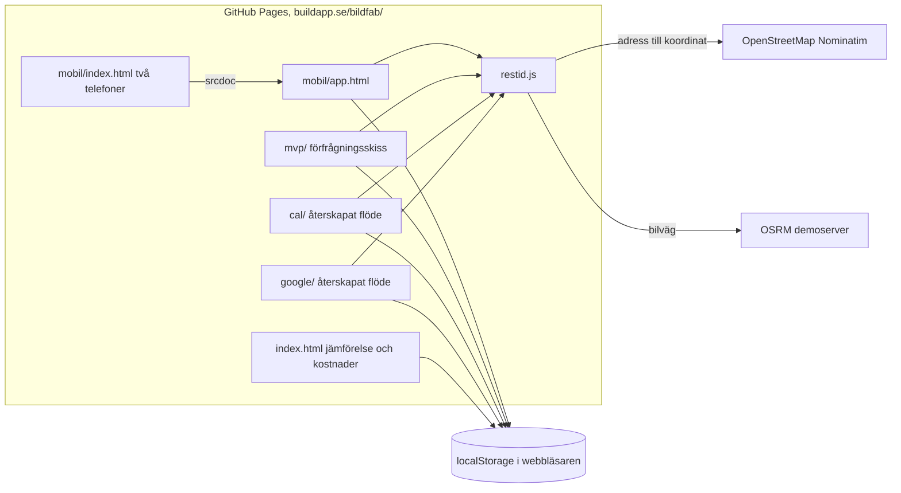

# Bokning för Bildfab

Demos som jämför bokningslösningar för Bildfabriken (bildfab.se, Umeå, 2 fotografer, mest mäklarjobb). Underlag till ägaren, inte en produkt.

| | |
|---|---|
| Host | GitHub Pages, `buildapp.se/bildfab/`, repo `buildapp-se/bildfab` (publikt, krävs för Pages). Alla sidor `noindex, nofollow`. |
| Stack | Statisk HTML + vanilla JS, inget bygge. Demodata i localStorage. |
| Sidor | `index.html` jämförelse och kostnader, `google/` och `cal/` återskapade flöden, `mvp/` förfrågningsskiss, `mobil/` två telefoner (mäklare + fotograf) med pling och ja/nej. |
| Restid | `restid.js`: Nominatim + OSRM-demo, bara för demo. Sidorna laddar den som `restid.js?v=...`: Cloudflare framför buildapp.se cachar JS (max-age 14400), så HTML blev ny men skriptet gammalt efter deploy 2026-11-24. Byt `v` när filen ändras. |
| Tester | `node --test test/restid.test.js` (låtsad fetch, inga nätanrop). Mutationstest: `npm i --no-save @stryker-mutator/core && npx stryker run`. |
| Ramning | Zonen sätter `frame-ancestors 'none'`, så `mobil/index.html` laddar `app.html` som `srcdoc`, inte `src`. Rollen läses från iframens `name`. |
| Bilder | `mvp/assets/` kommer från bildfab.se. Publicerade på Patriks begäran 2026-10-28 för att visa ägaren. Sedan 2026-11-25 nedskalade WebP (kort 720x540, hero 800 och 1600 px breda, `og.jpg` 1200x630); originalen i jpg finns i git-historiken före `851e34d`. |
| Typsnitt | Roboto, Roboto Mono och Inter som variabla latin-woff2 i `fonts/` med preload och `font-display: swap`, inga anrop till Google Fonts. Pilar och rutsymboler utanför latin ritas med systemtypsnittet. |

Rekommendation i sidan: Cal.com Free + "Kräver bekräftelse" (verifiera i riktigt konto), bygga själv på Cloudflare när restid som styr tider behövs.

## Architecture

Statiska demosidor utan server. Varje sida sparar sin demodata i webbläsarens localStorage; restiden hämtas direkt från webbläsaren.

## Stack

- Frontend: statisk HTML och vanilla JS, inget bygge
- Data: demodata i localStorage per webbläsare
- Restid: `restid.js` mot Nominatim och OSRM:s demoserver, bara för demo
- Tester: `test/restid.test.js` (node:test) för `restid.js`; sidskripten saknar tester
- Hosting: GitHub Pages, `buildapp.se/bildfab/`

## Audits
- Secrets: 2026-10-30, pass, gitleaks 0 findings in 5 commits
- Actions: 2026-10-30, n/a, no GitHub Actions workflows
- npm audit: 2026-10-30, n/a, no package.json
- Dependabot: 2026-10-30, pass, 0 open alerts
- Headers (automated): 2026-10-30, pass, 6 of 6 on buildapp.se/bildfab, Observatory B+ on buildapp.se
- WCAG 2.2 AA (automated): 2026-11-25, pass, axe 4.14.0 0 violations (A/AA and best practice) on all six pages plus mobil fotograf, mvp Fotografvy and google/cal admin, 390 and 1440 px, live (before: heading-order and region, moderate, on start page, mvp and mobil/app.html)
- Speed (automated): 2026-11-25, warn, Playwright 390 px with 4x CPU and Slow 4G, live: mvp LCP 2780 ms and 265 KB (before 13576 ms, 3018 KB), other pages LCP 828 to 1668 ms, CLS 0 to 0.004 except mobil/ 0.229 (header nav wraps when Roboto Mono replaces the fallback font, in backlog); no render-blocking requests; Cloudflare caches assets max-age 14400, HTML 600, no hashed assets
- UX (automated): 2026-11-24, warn, 7 of 8 script checks pass on all six routes with --interact (6 of 8 on live before the fix; 2026-10-30: needs-review, 6 of 6 without --interact); the one warn (Fitts, mvp) is opacity-0 radio and checkbox inputs inside 44 px labels, a script false positive; screenshot review 390 and 1440 px done, fixed 178 px horizontal scroll in mvp Fotografvy at 390 px
- OWASP Top 10: 2026-10-30, warn, code review (Mistral Large, medium and high checked by Claude), no live probe; 0 high, 1 medium: admin views have no access control, static demo with per-browser localStorage so no leak today; must not survive into the Worker build
- Mutation: 2026-11-04, pass, Stryker 98,51 % on restid.js (66 of 67, before 0 % with no tests), 1 survivor reviewed as equivalent; page scripts are UI, not mutation tested
